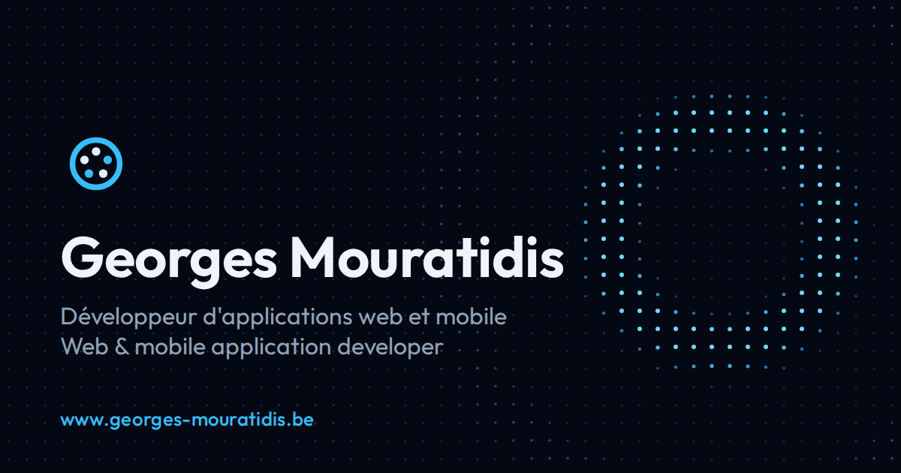

<div align="center">

# My World

**Personal portfolio of Georges Mouratidis, web and mobile application developer — an animated sea of dots where each bubble leads to a project.**

[](https://github.com/MGpro-grammer/my-world/actions/workflows/deploy.yml)


**[www.georges-mouratidis.be](https://www.georges-mouratidis.be)**



</div>

## Table of contents

- [About](#about)
- [Features](#features)
- [Tech stack](#tech-stack)
- [Architecture](#architecture)
- [Project structure](#project-structure)
- [Getting started](#getting-started)
- [Quality checks](#quality-checks)
- [Deployment](#deployment)
- [Privacy](#privacy)
- [License](#license)

## About

**My World** is the portfolio of Georges Mouratidis, a student in application development at
HE2B ESI (Brussels). Visitors move the mouse, or a finger, over a sea of dots that reacts with
waves; each bubble floating on it opens a project page with a demo video, the role played in the
project, its technologies and a link to its source code. A contact page gathers LinkedIn, GitHub,
email, phone and the résumé.

The site is available in French and English, and every page is prerendered so that it shows up
before the JavaScript has loaded and reads well in search engines and link previews.

## Features

- **Animated background** — a grid of dots driven by a small wave simulation, drawn with WebGL 2,
  with a 2D canvas fallback and a still version for visitors who ask for reduced motion.
- **Project bubbles** — spread evenly without overlap, keyboard accessible, with a plain list view
  as an alternative.
- **Project pages** — demo video loaded only when it comes into view, role, technologies and
  GitHub link.
- **Contact page** — email and phone shown on request only, availability by time slot in Belgian
  time, résumé as a picture with its PDF to download, in the language of the page.
- **Two languages** — French and English, chosen by the address (`/fr/…`, `/en/…`); the bare
  address sends each visitor to the language of their browser or to their last choice.
- **Search engines and sharing** — one HTML file per page and language, description, `canonical`,
  `hreflang`, Open Graph preview image and `sitemap.xml`.
- **Accessibility** — native dialogs, visible focus, text alternatives, and Lighthouse
  accessibility score of 100.

## Tech stack

| Area         | Technology                                                    |
| ------------ | ------------------------------------------------------------- |
| Language     | TypeScript 6 (strict)                                         |
| UI           | React 19, CSS Modules                                         |
| Routing      | React Router 8                                                |
| Graphics     | WebGL 2, Canvas 2D                                            |
| Build        | Vite 8, prerendering with `react-dom/server`                  |
| Tests        | Vitest                                                        |
| Code quality | ESLint, Prettier, TypeDoc (documentation check), EditorConfig |
| Hosting      | GitHub Pages, deployed by GitHub Actions                      |

## Architecture

The code is split by responsibility: `core/` holds logic that knows nothing about React or the
browser and is unit tested, `features/` holds the pages and their components, `hooks/` the shared
React hooks, and `i18n/` the languages and their texts.

The design patterns below come from _Dive Into Design Patterns_ (Alexander Shvets). Each one is
used where it solves a real problem, and the reason is written in the code documentation.

| Pattern       | Where                                                                       | Why                                                                                                                          |
| ------------- | --------------------------------------------------------------------------- | ---------------------------------------------------------------------------------------------------------------------------- |
| Facade        | `core/wave/WaveScene`                                                       | One entry point for the background: start, stop, resize, disturb. Its parts are injected, so it is tested without a browser. |
| Strategy      | `core/wave/WaveRenderer` and its three renderers                            | WebGL, animated 2D and still 2D drawings share one interface; `createWaveRenderer` picks one.                                |
| Flyweight     | `core/wave/DotStyleFactory`                                                 | Thousands of dots share a few dozen styles, used by both the 2D and the WebGL renderers.                                     |
| Observer      | `hooks/` (`useSyncExternalStore`, `ResizeObserver`, `IntersectionObserver`) | Components follow screen size, pixel ratio, reduced motion and visibility, and unsubscribe when unmounted.                   |
| State         | `features/bubbles/bubbleState`, `features/intro/introState`                 | The bubbles and the welcome screen are explicit state machines: a union of states and a pure reducer.                        |
| Virtual proxy | `features/project-page/ProjectVideo`, résumé picture                        | Heavy media are only requested when they are about to be seen.                                                               |

Two patterns were considered and left out on purpose: Singleton (module scope already gives one
instance where needed) and Adapter (the site uses no third-party service to adapt).

Adding a language means adding its code to `i18n/languages.ts`, a translation file and its
résumé; a missing text or file is a compile error. Adding a project means one entry in
`data/projects.ts`, its texts and its video: its page, its bubble, its prerendered files and its
sitemap entries follow.

## Project structure

```text
my-world/
├── .github/workflows/  # Checks, build and deployment to GitHub Pages
├── public/             # Files served as-is: résumés, videos, icons, robots.txt
├── scripts/
│   └── prerender.ts    # Writes one HTML file per page, 404.html and sitemap.xml
└── src/
    ├── main.tsx        # Entry point: takes over a prerendered page or draws it
    ├── entry-server.tsx # Renders a page to HTML, for the prerendering
    ├── routes.ts       # Every page and its address
    ├── App.tsx         # Shared layout: wave background and language switch
    ├── core/           # Wave simulation, renderers, bubble layout (no React)
    ├── components/     # Wave background, page head tags
    ├── features/       # Home, bubbles, project pages, contact, intro, languages
    ├── hooks/          # Shared React hooks (observers)
    ├── i18n/           # Languages, addresses and texts (French, English)
    ├── data/           # Projects, contact channels, site address
    ├── prerender/      # Pages to prerender, head tags, sitemap
    ├── assets/         # LinkedIn and GitHub logos
    └── styles/         # Global styles and design tokens
```

## Getting started

### Prerequisites

- Node.js 24 LTS or later (the prerendering script runs TypeScript directly)
- npm

### Installation

```bash
git clone https://github.com/MGpro-grammer/my-world.git
cd my-world
npm ci
```

### Available scripts

| Command                | Description                                             |
| ---------------------- | ------------------------------------------------------- |
| `npm run dev`          | Start the development server                            |
| `npm run build`        | Type-check, build and prerender every page into `dist/` |
| `npm run preview`      | Serve the production build locally                      |
| `npm test`             | Run the unit tests once                                 |
| `npm run test:watch`   | Run the unit tests on every change                      |
| `npm run lint`         | Lint the code with ESLint                               |
| `npm run docs:check`   | Check that every exported item is documented (TypeDoc)  |
| `npm run format`       | Format the code with Prettier                           |
| `npm run format:check` | Check formatting without changing files                 |

## Quality checks

- **Unit tests** with Vitest for the logic that can go wrong without being seen: wave physics and
  its fixed time step, renderer colors, bubble layout, state machines, language and address
  helpers, phone availability, prerendered pages and sitemap.
- **Documentation**: every exported function, class, interface, type and constant has a TSDoc
  comment, checked by TypeDoc.
- **Lighthouse** (mobile, production build): 97 to 99 in performance and 100 in accessibility,
  best practices and SEO on the home, project and contact pages.
- **Dependencies**: `npm audit` must report no vulnerability.

## Deployment

Each push to `main` runs [`deploy.yml`](.github/workflows/deploy.yml): `npm ci`, `npm audit`,
Prettier, ESLint, the documentation check, the tests and the build. The site is published on
GitHub Pages only if every step passes.

The custom domain `www.georges-mouratidis.be` is verified on the GitHub account and served over
HTTPS; `georges-mouratidis.be` redirects to it.

## Privacy

The email address and phone number are not written as such anywhere in the code or the published
files: they are assembled in the browser only when a visitor asks for them. The public résumés
contain no postal address, email or phone number, and personal data were blurred in the demo
videos. The site uses no cookies, no analytics and no third-party service; it only keeps, in the
visitor's own browser, their language choice and whether the welcome screen was already shown.

## License

The source code is released under the [MIT License](LICENSE).

The following content is **not** covered by that license and remains © Georges Mouratidis, all
rights reserved:

- the résumés (`public/cv/`);
- the demo videos and their posters (`public/videos/`);
- the preview image and the site icons (`public/social-preview.png`, `public/favicon.svg`,
  `public/apple-touch-icon.png`);
- the texts describing the author and his projects (`src/i18n/fr.ts`, `src/i18n/en.ts`).

The LinkedIn and GitHub logos (`src/assets/brands/`) belong to their respective owners.

---

<div align="center">

Made by **Georges Mouratidis** ·
[LinkedIn](https://www.linkedin.com/in/georges-mouratidis-a0b14a399) ·
[GitHub](https://github.com/MGpro-grammer)

</div>
